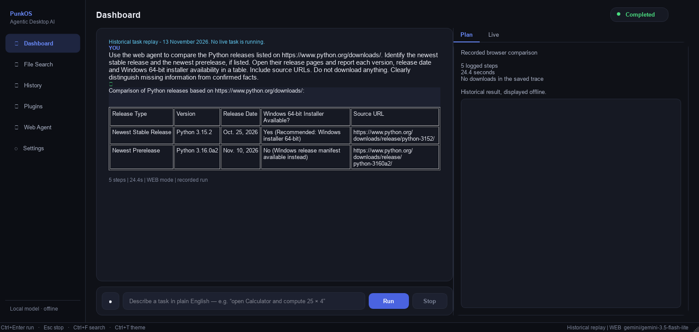

# PunkOS

**A Windows AI assistant that turns natural-language instructions into desktop and browser actions.**

PunkOS combines language-model planning with Windows UI Automation, Playwright browser control, action risk checks and outcome verification. A PyQt6 dashboard brings desktop tasks, file search, browser tools, task history and app plugins into one interface.

This repository contains the runnable project and a small showcase. Saved user data, development reports, benchmark recordings and model weights are excluded.

**Packaging validation:** 510 regression tests and 41 standalone checks passed in a fresh core installation. See [results and scope](docs/VALIDATION.md).



*The actual PyQt6 interface, rendered offline with a saved browser result from 13 November 2026. This is a historical replay prepared for the showcase, rather than a fresh live task. The replay notice and summary identify that distinction; Arial was used for font rendering.*

## What it does

| Capability | Implementation |
| --- | --- |
| Natural-language desktop tasks | Observe accessible Windows controls, plan actions, operate the mouse/keyboard and check outcomes. |
| Browser workflows | Inspect the DOM, navigate pages, interact with fields, manage tabs and track downloads with Playwright. |
| Local file search | Index supported documents in SQLite and retrieve matches using semantic embeddings when installed, or a weaker lexical fallback. |
| Multiple model providers | Local Ollama, plus optional Anthropic, Gemini, Grok and Groq adapters. |
| Action review and stopping | Risk assessment, confirmation prompts, path checks, Stop/Esc and the PyAutoGUI corner failsafe. |
| History and app knowledge | SQLite task records, timing metrics, procedural memory, Markdown skills and declarative app plugins. |

The desktop agent primarily grounds actions in accessibility data. Vision is optional. The project is a research prototype: supported features and automated regression coverage do not establish reliability on arbitrary applications or tasks.

## Requirements

- **Windows 10 or 11** for desktop control and Windows UI Automation.
- **Python 3.11 or 3.12**. Packaging checks for this repository used Python 3.11.9; see [validation](docs/VALIDATION.md).
- **Git** to clone the project.
- **Ollama** for local inference, or credentials and a supported model ID for an optional cloud provider.
- Internet access for initial Python packages, browser binaries and model downloads. Cloud inference and browsing require connectivity when used.

The original local-model design targets 8 GB RAM with `qwen2.5:3b` and no dedicated GPU. This is a design target, not a measured memory guarantee. CPU inference can be slow; additional memory helps when running browsers and embedding models alongside the agent.

## Quick start on Windows

Run these commands in PowerShell. All commands below assume you are in the repository root.

### 1. Clone and create a Python environment

```powershell
git clone https://github.com/hussainturii/punkOS.git
cd punkOS
py -3.11 -m venv .venv
.\.venv\Scripts\python.exe -m pip install --upgrade pip
```

If you installed Python 3.12, use `py -3.12` for environment creation. The commands use the environment's Python directly, so activating PowerShell scripts is unnecessary.

### 2. Install the application

For the full feature set, including semantic embeddings, voice input and the optional Anthropic client:

```powershell
.\.venv\Scripts\python.exe -m pip install -r requirements.txt
```

For a smaller installation with the desktop dashboard, Ollama, browser tools, document readers and lexical file search:

```powershell
.\.venv\Scripts\python.exe -m pip install -r requirements-core.txt
```

Choose one installation command. The full requirements include the core requirements. Embedding and speech models may download on first use; without the semantic backend, lexical search has lower recall for paraphrases.

Install the browser used by the web agent:

```powershell
.\.venv\Scripts\python.exe -m playwright install chromium
```

### 3. Install Ollama and pull the local model

Install [Ollama for Windows](https://ollama.com/download/windows), leave it running, then run:

```powershell
ollama pull qwen2.5:3b
ollama list
```

The Python `ollama` dependency is the client library; it does not install the Ollama desktop service or model weights.

### 4. Create your local configuration

```powershell
Copy-Item config.example.json config.json
```

Do this once. `config.json` is ignored by Git so local settings and any credentials saved through Settings are excluded from commits. The example selects Ollama, disables vision and uses portable storage paths.

| Setting | Default |
| --- | --- |
| `llm_provider` | `ollama` |
| `ollama.model` | `qwen2.5:3b` |
| `ollama.host` | `http://localhost:11434` |
| `history.db_path` | `data/history/punkos.db` |
| `memory.db_path` | `data/memory/memory.db` |
| `audit.db_path` | `data/history/audit.db` |
| `web.download_dir` | `data/downloads` |
| `safety.authorized_directories` | Your Documents, Downloads and Desktop, using `~` expansion |

Review authorized directories for your intended tasks. Runtime databases and indexes are created as needed. Launch from the repository root so all relative paths resolve consistently.

### 5. Check the model and start PunkOS

```powershell
.\.venv\Scripts\python.exe tests\test_ollama_smoke.py
.\.venv\Scripts\python.exe main.py
```

The smoke check contacts your local Ollama service and performs inference. For subsequent launches, run `main.py` again. Alternatively, `powershell -File .\start.ps1` uses `.venv` when present and creates `config.json` from the example if it is missing.

## First tasks to try

Start with short tasks in Calculator or an empty Notepad document:

```text
Open Calculator.
Open Calculator and compute 25 times 4.
Open Notepad and type Hello World. Leave the document unsaved.
```

Enter a task in the dashboard and select **Run**. Keep the desktop available while the agent works because desktop tasks control your mouse and keyboard. Review confirmation dialogs before accepting changes.

To run one task without the dashboard:

```powershell
.\.venv\Scripts\python.exe run_cli.py "Open Calculator"
```

The CLI still performs real computer actions. It is not a simulation.

| Shortcut | Action |
| --- | --- |
| `Ctrl+Enter` | Run the entered task |
| `Esc` | Request stop |
| `Ctrl+F` | File search |
| `Ctrl+H` | Task history |
| `Ctrl+T` | Toggle light/dark theme |
| `Ctrl+M` | Voice input, when dependencies and microphone are available |

The dashboard also has a **Stop** button. Moving the pointer to the top-left corner triggers PyAutoGUI's failsafe when it next performs an input operation. Stopping during a blocking operation may take time to return.

## Optional cloud providers

Local Ollama operation does not require an API key. To use a cloud adapter, set its key in the PowerShell session that launches PunkOS, choose the provider, and supply a model ID available to your account.

| Provider | Environment variable | `llm_provider` value |
| --- | --- | --- |
| Anthropic | `ANTHROPIC_API_KEY` | `anthropic` |
| Google Gemini | `GEMINI_API_KEY` | `gemini` |
| xAI Grok | `XAI_API_KEY` | `grok` |
| Groq | `GROQ_API_KEY` | `groq` |

For example, after setting `GEMINI_API_KEY` privately in your terminal:

```powershell
.\.venv\Scripts\python.exe check_provider.py --provider gemini --model "YOUR_AVAILABLE_MODEL_ID" --live --save
.\.venv\Scripts\python.exe main.py
```

Replace the model placeholder. `--live` sends an actual API request and can incur provider usage charges; `--save` selects the provider/model in your local configuration after a successful check. The helper supports Gemini, Grok and Groq. For Anthropic, install the full requirements and set its provider/model in local configuration or Settings.

Cloud model fields in the example are intentionally blank. Historical model names in source defaults or screenshots are not availability guarantees. Use a currently available API model ID. Keys for Gemini, Grok and Groq are read from environment variables; creating a `.env` file alone does not load those keys into this app.

With cloud inference, observations and task context used for reasoning leave the machine. Local Ollama inference stays local, while browsing and initial downloads still use the network.

## Testing and diagnostics

Create `config.json` before running tests. From the repository root:

```powershell
.\.venv\Scripts\python.exe -m unittest discover -s tests -q
.\.venv\Scripts\python.exe tests\test_integration.py
.\.venv\Scripts\python.exe tests\test_modules.py
.\.venv\Scripts\python.exe tests\test_ui.py
```

The three standalone scripts include function-based checks that `unittest discover` does not collect. Automated checks use synthetic observations, mocks and local browser fixtures; they do not demonstrate general model intelligence or arbitrary native-app success. See [the packaging validation record](docs/VALIDATION.md) for the observed results and scope.

To inspect an already-open Notepad window without typing or requesting inference:

```powershell
.\.venv\Scripts\python.exe check_accessibility.py --app notepad
```

Two small developer utilities are retained because tests import them:

- `benchmarks/decision_replay.py`: synthetic decision checks; executing it can call the configured model, but sends no desktop input.
- `benchmarks/efficiency_report.py`: reads timing aggregates from an existing local task-history database.

For a timing report after running tasks:

```powershell
.\.venv\Scripts\python.exe benchmarks\efficiency_report.py --database data/history/punkos.db --limit 20
```

Provider-call counts are not token counts or billing totals, and timing categories can overlap.

## Architecture

```text
Natural-language goal
        |
        v
Planner / route selection
        |
        +-- Desktop: UI Automation observations -> reasoning -> risk checks -> input
        +-- Browser: DOM observations -> reasoning -> risk checks -> Playwright actions
        +-- Files: index/search and structured file operations
        |
        v
Outcome verification -> task result, history and timing
```

The loop observes again as work progresses and can recover from bounded failures. Sending input successfully is separate from verifying the intended outcome. See [architecture notes](docs/ARCHITECTURE.md) for implementation entry points and limitations.

## Repository contents

```text
punkOS/
  main.py                    GUI entry point
  run_cli.py                 Single-task CLI
  start.ps1                  Convenience launcher
  config.example.json        Portable, credential-free configuration
  requirements-core.txt      Smaller runtime installation
  requirements.txt           Full feature installation
  check_provider.py          Optional cloud connection check
  check_accessibility.py     Read-only Windows UIA diagnostic
  core/                      Agent, providers, tools, safety and persistence
  ui/                        PyQt6 dashboard and panels
  data/prompts/              Planner and executor prompts
  data/skills/               Reviewable task guidance
  data/plugins/              Shipped Notepad, VS Code and Excel manifests
  tests/                     Automated checks and manual smoke-test scripts
  benchmarks/                Two utilities used by the test suite
  docs/                      Screenshot, architecture and validation notes
```

Only Notepad ships with Windows; the VS Code and Excel plugins require the corresponding apps to be installed. Plugins describe app expertise and workflows; they do not install applications.

The [repository content guide](docs/REPOSITORY_CONTENTS.md) explains what was retained and excluded. The app creates ignored local files including configuration, databases, indexes, logs and downloads. Do not add them to a showcase commit.

## Troubleshooting

| Symptom | What to check |
| --- | --- |
| `Cannot reach Ollama` | Start Ollama; if necessary run `ollama serve` in another terminal. Check the configured host. |
| Model not found | Run `ollama pull qwen2.5:3b`, or select an exact tag shown by `ollama list`. |
| Missing Python module | Use `.venv\Scripts\python.exe` consistently and install the selected requirements file in that environment. |
| Chromium executable missing | Run `.venv\Scripts\python.exe -m playwright install chromium`. |
| `config.json` missing | Copy `config.example.json` to `config.json`, or use the launcher. |
| File search uses lexical matching | Install full requirements and allow the embedding model to download on first use. |
| No useful app controls | Run the accessibility diagnostic. Canvas/custom interfaces may expose insufficient UI Automation data. |
| Local inference is slow or loops | Start with shorter goals, inspect observations and task history, and check the model and step budget. Larger models require more resources. |
| API credentials unavailable | Launch from the same terminal where the environment variable was set; verify the chosen model ID with the connection checker. |

## Limitations

The project remains a research prototype. Accessibility coverage varies between apps; canvas/custom UI, multi-monitor behavior and complex cross-app workflows need further acceptance testing. CAPTCHA handling is not provided. A successful model response or input event does not prove task completion, and outcome verification can still miss semantic errors.

Risk checks and confirmations reduce unintended actions but are not a complete boundary around arbitrary GUI interaction. The subprocess code runner uses validation and process separation; it is not equivalent to an operating-system security sandbox. Semantic file search is weaker when using its lexical fallback. Broad accuracy, memory usage and latency claims require repeated controlled measurements.

